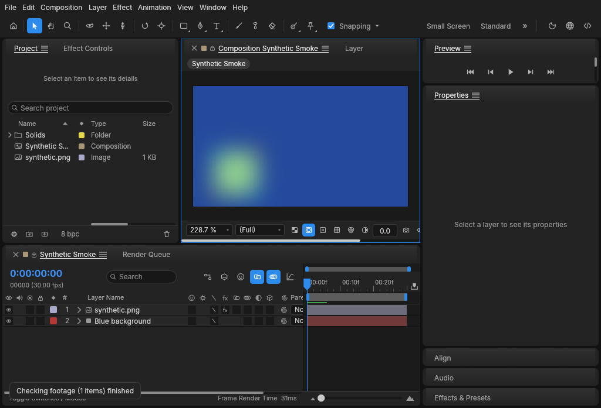
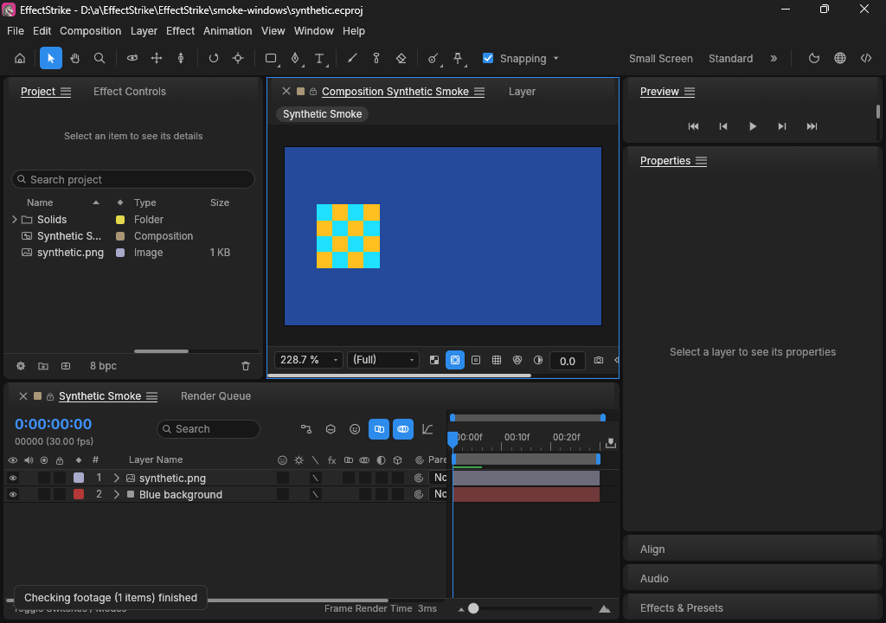
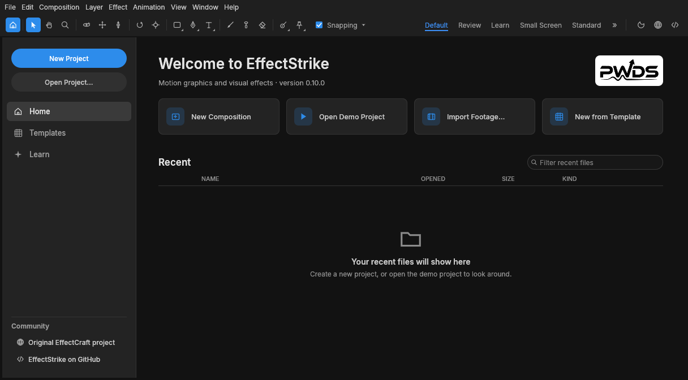
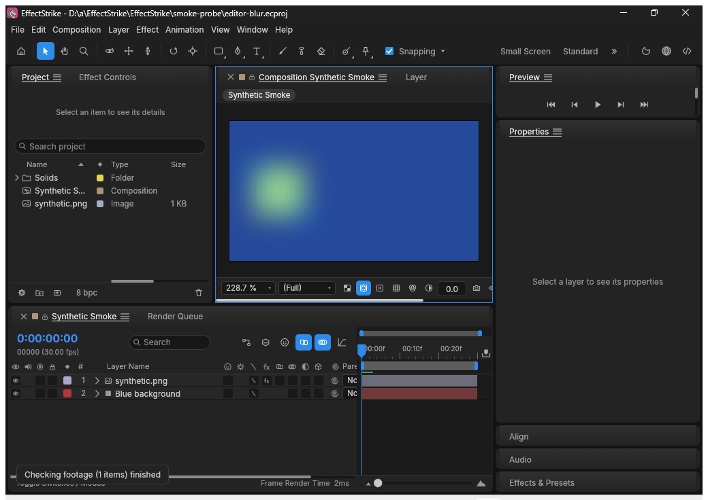
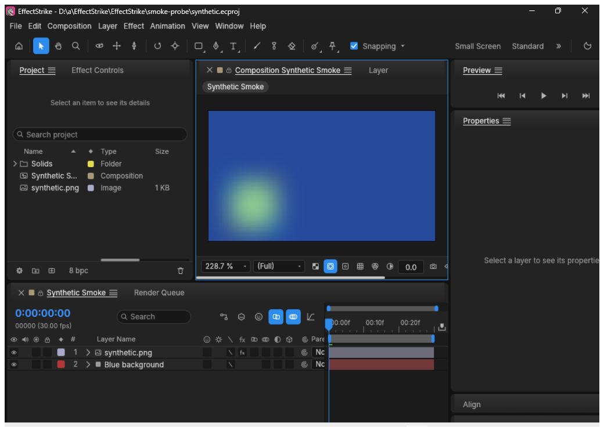

<p align="center">
  
</p>

# EffectStrike

**Open-source motion graphics and visual effects in Rust.** Build layered compositions, animate properties, preview frames in a native editor, and render from an automation-friendly CLI.



*Unmodified 1024×697 native frame captured on a standard hosted Windows 2025 runner on 23 October 2026 in [successful run 40019682910](https://github.com/Gerbzz/EffectStrike/actions/runs/40019682910), exact source `2ace3b77272434b4ff65635c1025105913f26862`. The real native compositor showing the saved synthetic blur-plus-position-expression project, layers and timeline. [Source, hashes and limits](docs/images/effectstrike-editor-windows2025-20261023.provenance.json).*

Saved synthetic 2D project opening and CPU rendering evidence, not real video footage, interactive timeline/effect editing, or real GPU-effects acceptance. These captures retain the icons from their recorded source; they do not verify the newer runtime branding described below.

<details>
<summary>Earlier native capture and its original provenance</summary>



*The actual EffectStrike desktop process on a standard hosted Windows 2025 runner. Its saved synthetic project shows the composition viewer, project bin, two layers, timeline, and a 2D preview. This pixel-exact 1024×720 app-window crop comes from [green run 38753532962](https://github.com/Gerbzz/EffectStrike/actions/runs/38753532962); the [full 1040×736 capture](docs/images/effectstrike-editor-windows2025.png) is retained.*

</details>

EffectStrike is an independent early-alpha fork of the complete [EffectCraft](https://github.com/storytold/effectcraft) compositor. This Rust workspace contains the desktop editor, project and render engine, effects, CLI, web frontend source and tests. The features below are present in the foundation; the [verified workflows](#verified-workflows) show which paths this fork has exercised.

## Compose and animate

- **Build layered scenes:** compositions, imported footage, transforms, timing, masks and effects are represented in the editor and project engine.
- **Animate properties:** keyframes, timeline and graph-editor source, expressions, cameras and lights support motion-design workflows.
- **Render and automate:** the render queue and CLI can produce frames and sequences. The native `.ecproj` format and internal `effectcraft-*` package names remain for compatibility.



*The real first-run Home window under Ubuntu 24.04/Xvfb and Mesa llvmpipe, cropped exactly to its 1216×672 app bounds from [green run 38717418028](https://github.com/Gerbzz/EffectStrike/actions/runs/38717418028). The [full 1280×800 capture](docs/images/effectstrike-home-ubuntu24.png) is retained. The approved PWDS mark appears on its light plaque.*

## Verified workflows

| Environment | Result |
| --- | --- |
| [Windows 2025](https://github.com/Gerbzz/EffectStrike/actions/runs/38753532962) | Built the native editor and CLI; imported a generated PNG; saved and reopened `.ecproj`; persisted two position keyframes; exported a [160×90 CPU frame](docs/images/effectstrike-synthetic-render-windows2025.png) and a three-frame PNG sequence; passed all 25 CLI tests; and opened the saved project in the editor shown above. |
| [Ubuntu 24.04](https://github.com/Gerbzz/EffectStrike/actions/runs/38717418028) | Built editor and CLI, exercised synthetic import/save/reopen, animation, PNG render and sequence export, passed CLI tests, and captured the native Home view above. |
| [Ubuntu effects proof](https://github.com/Gerbzz/EffectStrike/actions/runs/38953739017) and [Windows CPU effects proof](https://github.com/Gerbzz/EffectStrike/actions/runs/38953739288) | Saved and reopened a generated composition with Gaussian Blur 16 and a position expression; both CPU renderers changed 4,476 and 5,266 decoded RGB pixels at the two stages. Both jobs passed the full app/CLI build and CLI tests. The Windows capture step accepted a sized but black editor window, so that run does not verify visible GUI content. [Three retained CPU stages and exact limits](docs/EFFECTSTRIKE_STATUS.md#cpu-effect-and-expression-proof). |
| [Windows three-project startup probe](https://github.com/Gerbzz/EffectStrike/actions/runs/38957719951) | The native editor visibly opened the generated baseline, blur-only, and blur-plus-expression saved projects under an automated composition-content gate. All three spent about 50–51 seconds attempting unsupported Classic 3D GPU setup on the hosted Microsoft Basic Render Driver before drawing via CPU. These are native visual checks; this run did not execute the 25 CLI regression tests. |

### Saved effect projects in the Windows editor

| Baseline | Gaussian Blur 16 | Blur plus position expression |
| --- | --- | --- |
|  |  |  |

*Unmodified captures from [run 38957719951](https://github.com/Gerbzz/EffectStrike/actions/runs/38957719951), exact source `76ecce7`. The same generated project was saved at three stages; the native windows, titles, layers, timeline, and changing composition previews are visible. The hosted software adapter used CPU compositing after optional Classic 3D shader validation failed. These captures do not test interactive effect controls or real GPU effects.*

These checks use generated media and exercise a limited 2D composition. The hosted Windows adapter was Microsoft Basic Render Driver software DX12; it rejected the Classic 3D shader. An attempted optional GPU/CPU fallback timed out in the full render comparison and was reverted; the CPU renderer remains the supported route on that adapter. GPU 3D/effects on real hardware are **not verified**. One synthetic Gaussian Blur and position expression path has CPU render and native opening evidence; representative video footage, interactive timeline and effect-control editing, graph editing, broader effects, video delivery, macOS, recovery, accessibility and installers still need testing. See the [verification ledger](docs/EFFECTSTRIKE_STATUS.md). **No public installer or production release is offered.**

The initial application integration and screenshot evidence were merged through [PR #1](https://github.com/Gerbzz/EffectStrike/pull/1) in [commit `3d3f562`](https://github.com/Gerbzz/EffectStrike/commit/3d3f5623450f59ae61fb6ae5ba54fa102a366cf4).

## Build from source

Install Rust 1.95 or newer and the native graphics/windowing dependencies for your platform. The source retains compatible Cargo package and binary names:

```sh
git clone https://github.com/Gerbzz/EffectStrike.git
cd EffectStrike
cargo build --locked -p effectcraft -p effectcraft-cli
cargo run --locked -p effectcraft -- --demo
cargo run --locked -p effectcraft-cli -- info --empty
```

These are source commands, not installer instructions. The tested synthetic import/animation/render procedure and exact code revisions are in [docs/EFFECTSTRIKE_STATUS.md](docs/EFFECTSTRIKE_STATUS.md). EffectStrike does not support After Effects `.aep`/`.aepx` projects or plug-ins.

## Project and credits

The full foundation is pinned to [EffectCraft commit `0311bdc34d0dc10c2d18ff7875b4f52d483e5e27`](https://github.com/storytold/effectcraft/commit/0311bdc34d0dc10c2d18ff7875b4f52d483e5e27). The original [MIT](LICENSE-MIT) and [Apache-2.0](LICENSE-APACHE) licences, [NOTICE](NOTICE) and [asset attribution](ATTRIBUTION.md) remain. The inherited openly licensed unicorn artwork is preserved for history and the packaging routes not yet migrated below.


EffectStrike is published by PWDS. Its existing mark has [separate brand terms](assets/branding/LICENSE-brand.txt). EffectStrike is independent of and not endorsed by ArtCraft.

## Product artwork

The EffectStrike product mark above has an original [SVG master](assets/branding/EffectStrike-logo.svg) and matching PNG. [Asset provenance](assets/branding/EffectStrike-logo.provenance.json) records how it was created and the exact file hashes. The PWDS publisher artwork and inherited software credits are unchanged. Existing screenshots retain the artwork visible in their original captured builds.

All native window-icon source paths now use the same unchanged 1024×1024 product PNG. The AppImage helper derives a transparent 256×256 PNG in memory for its hicolor entry and refreshes an outdated icon only for an entry it owns; installed-package and user-owned entries are left alone. This is not OS titlebar/taskbar/Dock visual acceptance.

The remaining package and web source routes use separately named [product exports](assets/branding/icons/README.md): Windows executable/MSI ICO, Linux/AppImage/Flatpak/FreeBSD hicolor files, macOS ICNS, and web/PWA icons. Original upstream assets remain preserved. **Source-only export phase:** the macOS ICNS must be generated by the reviewed native iconutil job, inspected and committed before this package-logo work is complete. No installer, release, native macOS window, or desktop-shell icon acceptance is claimed by this source checkpoint.

Existing screenshots retain their recorded artwork and do not establish the new resource paths. The older `packaging/icons.sh` remains an upstream-artwork regeneration tool; `cargo xtask product-icons --write` exports this product family without changing those originals.
