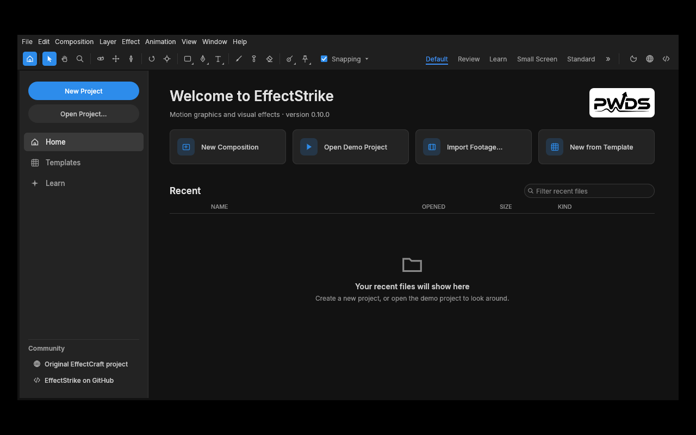

# EffectStrike

**Open-source motion graphics and visual effects in Rust.** Build layered compositions, animate properties, preview frames in a native editor, and render from an automation-friendly CLI.


*The actual EffectStrike desktop process on a standard hosted Windows 2025 runner. Its saved synthetic project shows the composition viewer, project bin, two layers, timeline, and a 2D preview. This unmodified 1040×736 window capture comes from [green run 38753532962](https://github.com/Gerbzz/EffectStrike/actions/runs/38753532962).*

EffectStrike is an independent early-alpha fork of the complete [EffectCraft](https://github.com/storytold/effectcraft) compositor. This Rust workspace contains the desktop editor, project and render engine, effects, CLI, web frontend source and tests. The features below are present in the foundation; the [verified workflows](#verified-workflows) show which paths this fork has exercised.

## Compose and animate

- **Build layered scenes:** compositions, imported footage, transforms, timing, masks and effects are represented in the editor and project engine.
- **Animate properties:** keyframes, timeline and graph-editor source, expressions, cameras and lights support motion-design workflows.
- **Render and automate:** the render queue and CLI can produce frames and sequences. The native `.ecproj` format and internal `effectcraft-*` package names remain for compatibility.



*The real first-run Home window under Ubuntu 24.04/Xvfb and Mesa llvmpipe, captured at 1280×800 in [green run 38717418028](https://github.com/Gerbzz/EffectStrike/actions/runs/38717418028). The approved PWDS mark appears on its light plaque.*

## Verified workflows

| Environment | Result |
| --- | --- |
| [Windows 2025](https://github.com/Gerbzz/EffectStrike/actions/runs/38753532962) | Built the native editor and CLI; imported a generated PNG; saved and reopened `.ecproj`; persisted two position keyframes; exported a [160×90 CPU frame](docs/images/effectstrike-synthetic-render-windows2025.png) and a three-frame PNG sequence; passed all 25 CLI tests; and opened the saved project in the editor shown above. |
| [Ubuntu 24.04](https://github.com/Gerbzz/EffectStrike/actions/runs/38717418028) | Built editor and CLI, exercised synthetic import/save/reopen, animation, PNG render and sequence export, passed CLI tests, and captured the native Home view above. |

These checks use generated media and exercise a limited 2D composition. The hosted Windows adapter was Microsoft Basic Render Driver software DX12; it rejected the Classic 3D shader. A bounded fallback fix is being validated in [draft PR #1](https://github.com/Gerbzz/EffectStrike/pull/1), and GPU 3D/effects on real hardware are **not verified**. Representative video footage, interactive timeline editing, graph editing, effect output, video delivery, macOS, recovery, accessibility and installers also need testing. See the [verification ledger](docs/EFFECTSTRIKE_STATUS.md). **No public installer or production release is offered.**

The screenshots and workflow evidence come from application work in [draft PR #1](https://github.com/Gerbzz/EffectStrike/pull/1); that application code is **not merged into `main`**.

## Build from source

Install Rust 1.95 or newer and the native graphics/windowing dependencies for your platform. The source retains compatible Cargo package and binary names:

```sh
git clone https://github.com/Gerbzz/EffectStrike.git
cd EffectStrike
cargo build --locked -p effectcraft -p effectcraft-cli
cargo run --locked -p effectcraft -- --demo
cargo run --locked -p effectcraft-cli -- info --empty
```

These are source commands, not installer instructions. The tested synthetic import/animation/render procedure and exact code revisions are in [docs/EFFECTSTRIKE_STATUS.md](docs/EFFECTSTRIKE_STATUS.md). EffectStrike does not support After Effects `.aep`/`.aepx` projects or plug-ins.

## Project and credits

The full foundation is pinned to [EffectCraft commit `0311bdc34d0dc10c2d18ff7875b4f52d483e5e27`](https://github.com/storytold/effectcraft/commit/0311bdc34d0dc10c2d18ff7875b4f52d483e5e27). The original [MIT](LICENSE-MIT) and [Apache-2.0](LICENSE-APACHE) licences, [NOTICE](NOTICE) and [asset attribution](ATTRIBUTION.md) remain. The inherited openly licensed unicorn app icon is temporary source artwork, not a finished EffectStrike icon.


EffectStrike is published by PWDS. Its existing mark has [separate brand terms](assets/branding/LICENSE-brand.txt). EffectStrike is independent of and not endorsed by ArtCraft.
